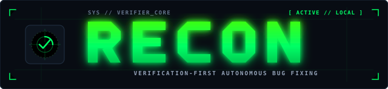
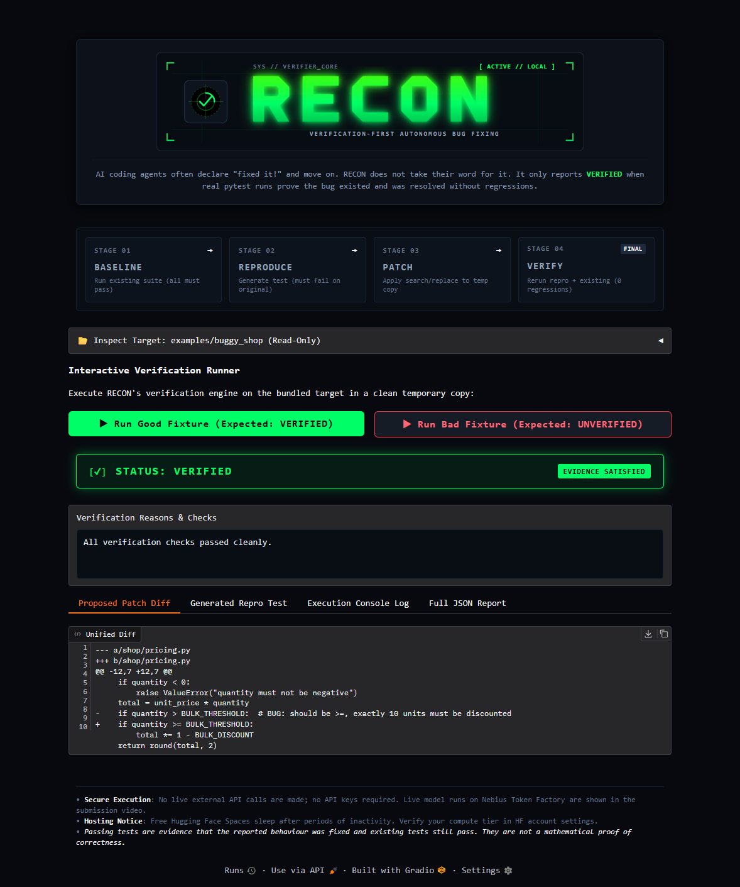

<p align="center">
  
</p>

<p align="center">
  
</p>

# RECON — verification-first autonomous bug fixing

RECON takes a Python bug report and a local project, then **reproduces the bug with a generated pytest test, patches the code in a temporary copy, and decides the outcome from real test results** — never from the model's claim.

| Status | Meaning (computed by Python in `recon/verify.py`) |
|---|---|
| `VERIFIED` | The repro test **failed** on the unmodified code (every baseline run), **passes** after the patch (every rerun), no protected file was touched, and no previously-passing existing test regressed. |
| `UNVERIFIED` | A patch was produced but at least one requirement failed (still failing, regression, rejected patch, tampering, flaky). |
| `COULD NOT REPRODUCE` | The generated test did not fail cleanly on the original code (it passed, timed out, or errored). No patch call is spent. |
| `ERROR` | Operational problem (missing config, API error, budget exhausted, bad project). Not a verification verdict. |

> **Passing tests are evidence of a fix, not mathematical proof of correctness.**

## How it works

```
bug report + project
   │  copy safe files to a temp dir (no .git/venv/secrets/symlinks/huge files)
   ▼
run existing tests (baseline)
   ▼
MODEL CALL 1 → reproduction test ──► AST safety scan ──► run on original code (x RECON_REPEATS)
   │                                   must FAIL cleanly, else ONE repair call, else COULD NOT REPRODUCE
   ▼
MODEL CALL 2 → search/replace edits ──► validate paths/syntax ──► apply to a SECOND temp copy
   ▼
rerun repro test (x RECON_REPEATS) + existing tests + hash-check every test/config file
   ▼
verify.evaluate() → status      (one repair call allowed if not VERIFIED)
```

Your original files are never modified. The patch is shown as a unified diff.

## Install

**Linux / macOS**
```bash
python3 -m venv .venv && source .venv/bin/activate
pip install -r requirements.txt
```
**Windows PowerShell**
```powershell
py -m venv .venv
.\.venv\Scripts\Activate.ps1      # if blocked: Set-ExecutionPolicy -Scope Process Bypass
pip install -r requirements.txt
```
Python 3.9+ required; the only dependency is `pytest`.

## Run the unit tests (no API, no credits)
```bash
python -m pytest
```

## Demo 1 — fully local, zero credits
Replays canned model responses through the **real** pipeline (real pytest runs, real verification).
```bash
python -m recon --project examples/buggy_shop --bug-report examples/buggy_shop/bug_report.md --offline-fixtures examples/fixtures/good   # VERIFIED, exit 0
python -m recon --project examples/buggy_shop --bug-report examples/buggy_shop/bug_report.md --offline-fixtures examples/fixtures/bad    # UNVERIFIED, exit 1
```
(Same commands in PowerShell: just use one line, or backtick `` ` `` for continuation.) Examples of output: `docs/sample_output_verified.txt`, `docs/sample_output_unverified.txt`, `docs/sample_report_verified.json` (these came from offline runs, not a live model).

## Demo 2 — with a model on Nebius Token Factory
1. Create an account and an **API key** in the Nebius Token Factory console.
2. In the Nebius model catalog, pick an **NVIDIA open model** offered there. Copy its **exact model ID** from the catalog. Do not guess it.
3. From the Nebius docs, copy the **OpenAI-compatible base URL** (the URL that `/chat/completions` is appended to). RECON deliberately has no default so it cannot be wrong.
4. Configure:
```bash
cp .env.example .env        # Windows: Copy-Item .env.example .env
# edit .env: NEBIUS_API_KEY, NEBIUS_BASE_URL, NEBIUS_MODEL
python -m recon --check-config
python -m recon --project examples/buggy_shop --bug-report examples/buggy_shop/bug_report.md
```
Outputs land in `recon_output/`: `recon_report.json`, `test_recon_repro.py`, `patch.diff`. Exit codes: 0 VERIFIED, 1 UNVERIFIED, 2 COULD NOT REPRODUCE, 3 ERROR.

Your own project: `python -m recon --project path/to/project --bug "describe the bug"` (or `--bug-report file.md`). Tests must run with `python -m pytest` from the project root.

## Cost controls
* **Call budget** `RECON_MAX_API_CALLS` (default 4, also `--max-calls`): counted *before* each request, so failed calls still count.
* Typical run = **2 calls** (repro + patch); worst case 4 (one repair per stage). `max_tokens` (`RECON_MAX_OUTPUT_TOKENS`) is set on every request; input is capped by `RECON_MAX_CONTEXT_CHARS` (~4 chars ≈ 1 token).
* Explicit HTTP timeout, **no automatic retries**, no loops, no embeddings/search/agents. Test results are interpreted by Python, never the model.
* Token usage is logged when the API reports it. **These are application-level limits only — not a hard account-wide cap.** Check the Nebius console for real usage.

## Security model and limitations (read this)
* **The generated test and the patched code are executed locally.** Mitigations: AST scan of the test (no os/sys/subprocess/network/`open`/`eval`), scan of text added by patches, patches limited to existing `.py` source files, a fixed pytest command, scrubbed environment (API keys are *not* passed to the test process), temp HOME, timeout, process-group kill and CPU/file-size rlimits on POSIX.
* **This is not a sandbox.** There is no network or filesystem isolation, and the scans are heuristics. For untrusted repos, run RECON in a container/VM.
* Test integrity: patches cannot touch tests, `conftest.py`, pytest config or the repro file, and all such files are SHA-256 hashed before/after.
* The reproduction test is LLM-written. A failure for an unrelated reason would still count as "reproduced" — **read `recon_output/test_recon_repro.py`**.
* Edit format is search/replace JSON (more robust than LLM unified diffs). New-file creation is unsupported.
* Not tested against the real Nebius API in development (only a local OpenAI-compatible mock). Model behavior and JSON compliance vary: if a model returns invalid JSON the run stops with `ERROR` (no retry, to protect credits).
* Python/pytest only; no `src/` layout autodetection (the project root is on `sys.path` via `python -m pytest`).

## Troubleshooting
| Symptom | Fix |
|---|---|
| `Missing environment variables` | Fill `.env`; check with `--check-config`. |
| `HTTP 401/403` | Wrong/expired key. |
| `HTTP 404` or `unexpected API response shape` | Wrong `NEBIUS_BASE_URL` or model ID; re-copy from Nebius docs/catalog. |
| `cut off by max_tokens` | Raise `RECON_MAX_OUTPUT_TOKENS` (costs more). |
| `model reply was not valid JSON` | Try another model; reasoning models that put text outside JSON may fail. |
| `COULD NOT REPRODUCE` | Make the bug report more specific (function name, input, expected vs actual). |
| `existing tests ... ERROR` | The project's own suite doesn't run with `python -m pytest` from the root. |
| `API-call budget exhausted` | Intended. Raise `RECON_MAX_API_CALLS` only if you accept the spend. |

## Layout
```
recon/  cli.py agent.py llm.py runner.py verify.py patching.py safety.py inspect_project.py fs.py prompts.py config.py
tests/  unit + offline end-to-end tests (+ mock_server.py for the HTTP path)
examples/buggy_shop/  demo project with a deliberate off-by-one bug
examples/fixtures/    canned model responses (good / bad) for credit-free demos
docs/   sample outputs and JSON report
```
